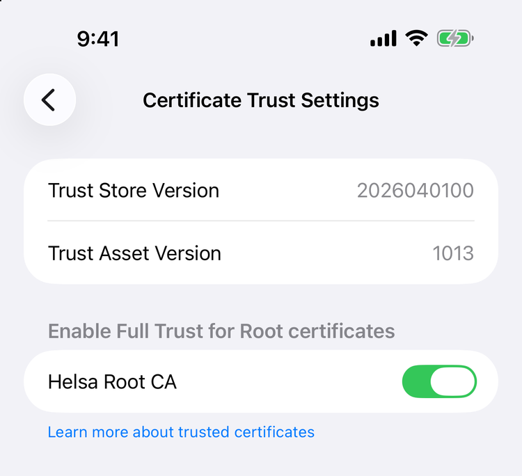

:::danger[⛔ Not on the server — on your own computer]
**Everything under [Issuing](#issuing--on-your-own-computer) runs on your laptop or desktop, not on
the Helsa server.** It creates the root key of your CA, and whoever holds that key can mint a client
certificate for your API. If you followed the Quick start, your clone is on the server: **clone the
repository a second time on your own computer** for this page. Only three files ever go to the
server — `ca.crt`, `server.crt`, `server.key` — and `ca.key` never does.

`make ca` refuses to run where it sees a configured `../.env` or running Helsa containers.
:::

## Why mutual TLS, and not a login page

The API is reachable from the internet. Anything reachable from the internet is
scanned continuously by automated tools looking for known vulnerabilities — not
because anyone is interested in you, but because everything gets scanned.

A password or a bearer token is checked by the application, which means the
request has already been parsed by TLS termination, an HTTP server, a router, and
some middleware. Every one of those is code that can have a bug.

**Mutual TLS moves the gate down to the handshake.** The proxy demands a client
certificate signed by *your* certificate authority before it will complete a TLS
connection. A scanner has no such certificate, so it never gets to send a single
byte of HTTP. The attack surface facing the internet shrinks to the TLS
implementation itself.

The device token still exists on top of it. Two independent factors: one transport,
one application.

## Why a private CA, and no ACME

There is no public certificate authority in this design, and no Let's Encrypt.

- The clients are yours. You know all of them, personally, and there are one or two.
- A public CA can only vouch for *server* identity. It cannot help with the thing
  that matters here, which is proving that a client is your phone.
- Certificates are issued with `openssl` and a Makefile, not a running CA service.
  This means **the root key can live offline** — in a password manager, brought out
  only when you sign something. A CA daemon must keep it online.

Key algorithm throughout: **ECDSA P-256**. Modern, small, well supported by Apple
platforms.

## The three certificates

```
Helsa Root CA                          10 years, key kept OFFLINE
├── server certificate                 398 days, lives on the proxy
└── client certificates
    ├── iphone                         730 days, lives in the phone's Keychain
    └── ipad, laptop, …                one per device, never shared
```

| Certificate | Lifetime | Why that number |
|---|---|---|
| Root CA | 10 years | Replacing it is the one operation that can lock you out. Do it rarely and deliberately. |
| Server | 398 days | Apple platforms cap how long they will trust a server certificate. 398 days is the value at which the question never comes up. Renew yearly. |
| Client | 730 days | **Deliberately long.** If the phone is offline longer than its certificate lives, it cannot renew — renewal needs a connection, and the connection needs the certificate. Short-lived client certificates create a deadlock. |

## Issuing — on your own computer

:::danger
**Do this on your own computer, not on the server.** The root key must never be on the server
(see below), and the commands here create it wherever you run them. If you followed the [Quick
start](/getting-started/quick-start/), your clone is on the server — clone the repository a
second time on your workstation for this step. All you need there is `git`, `make` and `openssl`.
:::

```bash title="On your computer"
git clone https://github.com/nordic-sys/helsa.git
cd helsa/deploy/pki

make ca                       # once, ever
make server                   # the proxy's certificate
make client NAME=iphone       # per device, produces a .p12 bundle
```

Everything lands under `pki/out/`, which is git-ignored.

:::danger[Edit `server.cnf` BEFORE `make server`]
The server certificate is only valid for the names written into `deploy/pki/server.cnf`, and the
file ships with example names. Open it and replace them — `CN`, every `DNS.n` and `IP.n` under
`[ alt ]` — with **the name the phone will use** (the public name too, if it will connect from
outside) and the server's LAN address:

```ini title="On your computer"
[ dn ]
CN = helsa.yourname.example        # the main name

[ alt ]
DNS.1 = helsa.yourname.example     # the name the phone uses
DNS.2 = helsa-home.lan             # any internal name you want to reach it by
IP.1  = 192.168.1.50               # the server's LAN address
```

`make server` refuses to sign while the example names (`helsa.example.com`, `192.168.1.10`) are
still there. Change the names later? Edit the file, delete `out/server/`, run `make server` again,
and install the new pair on the server — the CA, and so the phone, stay as they are.
:::

:::danger
**The root key leaves this machine and goes into your password manager.** Copy
`out/ca/ca.key` there now, before you forget. It is the trust anchor for
everything; if it leaks, someone can mint a client certificate for your API, and
if you lose it you must rebuild the entire PKI. It must never be on the server.
:::

`make ca` refuses to overwrite an existing CA. That guard is intentional —
regenerating the CA silently invalidates every certificate you have issued.

## Installing on the server

```
/opt/helsa/pki/
├── ca.crt        0644   used to verify client certificates
├── server.crt    0644
└── server.key    0600   readable only by the proxy
```

From your workstation, in `helsa/deploy/pki` — replace `server` with your server's SSH name and
`~/helsa/deploy` with wherever the Quick start clone lives:

```bash title="On your computer"
scp out/ca/ca.crt out/server/server.crt out/server/server.key server:/tmp/
ssh server '
  sudo install -d -m 0755 /opt/helsa/pki &&
  sudo install -m 0644 /tmp/ca.crt /tmp/server.crt /opt/helsa/pki/ &&
  sudo install -m 0600 /tmp/server.key /opt/helsa/pki/ &&
  rm -f /tmp/ca.crt /tmp/server.crt /tmp/server.key &&
  cd ~/helsa/deploy && make prod-caddy-check &&
  docker compose -f docker-compose.yml -f docker-compose.prod.yml restart proxy'
```

Note the `rm` — do not leave a private key in `/tmp`. ⚠️ The restart needs **both** Compose files:
the proxy exists only in the production overlay, so a plain `docker compose restart proxy`
answers `no such service: proxy` and restarts nothing. `make prod-caddy-check` validates the
configuration against the certificates first, so a mistake fails here rather than taking the
proxy down.

## Installing on the phone
Two separate things must go onto the device, and **both are required**:

**1. `ca.crt` — so the phone trusts your server.**

Transfer it (AirDrop, mail to yourself, download over LAN) and open it. iOS
downloads it as a *profile* that you then install in Settings.

:::danger
**Installing the CA is not the same as trusting it.** After installing the
profile you must additionally enable it under
**Settings → General → About → scroll to the very bottom → Certificate Trust Settings**, and switch
**Helsa Root CA** on under *Enable full trust for root certificates*. ⚠️ Nothing points you there: the
profile itself (General → VPN & Device Management → Helsa Root CA) looks complete and correct
without it — the fingerprint, the dates, everything — so checking the profile proves nothing. Until you flip that
switch the certificate is present but inert, and the app reports a connection
error that looks like a network problem. This is the single most common failure
in this whole setup.
:::



⚠️ **The toggle is the whole point.** Installing the certificate is not the same
as trusting it: without that switch the app reports what looks like a network
error, and nothing anywhere says the certificate is the reason.

**2. `<name>.p12` — so the phone can identify itself.**

⚠️ **This one does not go in the way the CA did.** A `.p12` installed as a profile in the iPhone's
Settings lands in the system keychain, which the app cannot read — the connection then fails as if
there were no certificate at all. Import it **inside the app**: put the file on the phone (AirDrop
to Files, or the Files app over the network), then in Helsa open **Settings ▸ Export ▸ Your own
server ▸ Client certificate ▸ Choose a file…**, pick the `.p12` and type the password that
`make client` generated into `out/clients/<name>/p12-password.txt`. The screen then says
*"A certificate is installed."*

:::danger
**Move that password into your password manager and delete the file.** It
protects the private key of a certificate that grants access to your API.
:::

If iOS refuses the `.p12`, the encryption may be too new for the device; the PKI
README documents a `-legacy` variant. Use it only if you must — it falls back to
older, weaker ciphers.

⚠️ **The app does not pin your CA.** It trusts the server through the system trust store, which
is why step 1 — installing and trusting `ca.crt` — is required at all. What keeps a stranger's
server out is the client certificate: a server that does not have your CA cannot complete the
handshake with it.

:::tip[Next: step 4]
**→ [Step 4: First sync](/getting-started/first-sync/)**

The server has its certificate and the phone trusts your CA and holds its own `.p12` — that was step 3. Everything below this box is reference for later: rotating, revocation, expiry, troubleshooting.
:::

## Rotating
Three scenarios, in increasing order of danger.

### Server certificate — yearly, safe

Nobody can be locked out: the phone trusts the **CA**, not the individual server
certificate.

```bash title="On your computer"
make server
# copy to the server, restart the proxy
make expiry
```

Keep the previous `server.crt` and `server.key` until the new one is proven. Rolling
back is a file copy and a restart.

### Client certificate — every two years, or on device replacement

```bash title="On your computer"
make client NAME=iphone
```

:::danger
**Install the new `.p12` on the phone before removing the old identity.** If you
delete first and the import then fails, you have no working client certificate,
and the phone cannot sync while you sort it out.
:::

If a device was **lost** rather than replaced, replacing its certificate achieves
nothing — the old one is still valid and still in someone's pocket. Rotate the CA.

### Root CA — every ten years, or after compromise

:::danger
**This is the one operation that can lock you out permanently.** If you switch
the proxy to a new CA before the phone has the new certificates, the phone cannot
connect — and it would have to connect in order to receive them. Do this at home,
with the phone in your hand, never remotely and never before a trip.
:::

The order is not optional:

1. Move the old CA aside and generate a new one: `mv out/ca out/ca-old && make ca`
2. Issue new server and client certificates from the new CA.
3. **Install the new `ca.crt` and `.p12` on the phone, and enable trust.** The
   phone still works at this point, because the proxy is still on the old CA.
4. *Now* replace `ca.crt`, `server.crt`, and `server.key` on the proxy and reload.
5. Verify a real sync from the phone. If it fails, restore the old files from
   `out/ca-old` and reload — you are back where you started.
6. Only after a successful test, delete the old CA and the old identity.

The server side is always recoverable through SSH or the hypervisor console. The
phone is the part that can get stranded, which is why it goes first.

## No CRL, no OCSP

There is no revocation infrastructure, and this is a decision rather than an
omission.

A certificate is a signed statement that stays true until it expires; revoking one
requires an out-of-band channel telling verifiers it is dead. Both standard
channels have real costs:

- **CRL** — a signed list published over HTTP. It must be re-signed and republished
  periodically **even when empty**. If it lapses, strict clients treat that as an
  error rather than as "nothing revoked", and everyone locks themselves out weeks
  after the CA quietly stopped publishing.
- **OCSP** — a live responder answering per-certificate queries. It sees who
  connects to what and when. Hard-fail makes it a single point of failure for the
  whole service; soft-fail makes the check worthless, since anyone able to
  intercept traffic can also block the OCSP query. Stapling fixes this for *server*
  certificates only — client-side stapling is essentially unimplemented, so it does
  not help the case at hand.

The industry answer is short-lived certificates instead of revocation. That does
not fit here, for the deadlock reason above.

**So revocation here means rotating the CA.** With one or two devices, all of them
in your house, that is ten minutes of work. Revocation infrastructure starts paying
off when you *cannot* reach every certificate holder in person.

## Expiry is a silent failure

```bash title="On your computer"
make expiry
```

Prints days remaining for every certificate, flagging under 90 days and under 30.

An expired certificate does not produce an error message anywhere you look. The
phone simply stops syncing, and because it buffers locally, the data is not lost —
so nothing appears wrong until you go looking for last month's numbers.

Two mitigations, and you want both:

1. Put the expiry dates in a calendar. `make server` and `make client` print them.
2. Run the [freshness alert](/integrations/home-assistant/#the-alert-that-matters).
   It catches expiry, stale DNS, a dead worker, and a full disk with one mechanism,
   because all of them look identical from the outside: no new data.

## Troubleshooting

| Symptom | Cause | Fix |
|---|---|---|
| Phone says the connection is not secure, or the app says the TLS connection could not be made | CA installed but trust not enabled — the most likely cause by far, even when the profile looks fine | General → About → bottom → Certificate Trust Settings → switch Helsa Root CA on |
| Same, and trust is on | The phone holds a different CA than the one that signed the server — e.g. one made earlier and thrown away. All of them are called "Helsa Root CA" | Compare the SHA-256 fingerprint in the profile's details with `openssl x509 -in out/ca/ca.crt -noout -fingerprint -sha256` |
| Handshake fails, no HTTP status | Client certificate missing or from a different CA | `openssl verify -CAfile out/ca/ca.crt out/clients/iphone/iphone.crt` |
| Works by IP address, fails by hostname | The hostname is missing from the server certificate's SAN list | Add it to `server.cnf`, `make server`, redeploy |
| Works by hostname, fails by IP | Expected. Caddy enforces strict SNI/Host matching once client authentication is configured. | Use the hostname. |
| `.p12` rejected by iOS | Encryption algorithm | See the `-legacy` note above |
| The app behaves as if there were no client certificate, although you installed the `.p12` | It was installed as a profile in the iPhone's Settings — the app cannot see that keychain | Import it in the app: Settings ▸ Export ▸ Your own server ▸ Client certificate |
| Lost `ca.key` | It was not in the password manager | Full CA rotation. There is no other way. |
